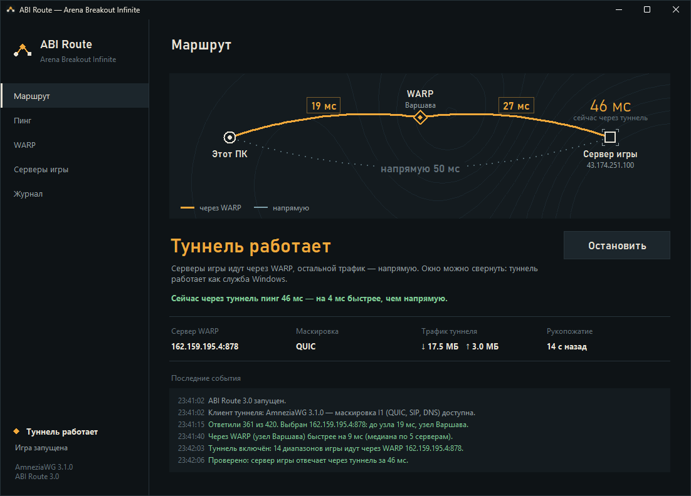

# ABI Route — WARP только для Arena Breakout Infinite

Пускает через Cloudflare WARP **только серверы игры**. Браузер, Discord, загрузки и всё остальное идут напрямую.
Туннель работает как служба Windows — окно можно закрыть.



## Установка

1. Установите **AmneziaWG 2.0 или новее**: [страница загрузки](https://github.com/amnezia-vpn/amneziawg-windows-client/releases),
   файл `amneziawg-amd64-…msi`. С версии 2.0 работает маскировка QUIC, SIP и DNS — в России без неё WARP часто
   блокируют. Старый AmneziaWG 1.0.x и обычный WireGuard тоже подойдут, но с меньшим выбором маскировки.
2. Возьмите `ABIRoute.exe`: вкладка **Actions** этого репозитория → последняя сборка → артефакт **ABIRoute**.
   Или соберите сами: запустите **build.bat** (нужен Python 3.10+), файл появится в `dist\ABIRoute.exe`.

## Как пользоваться

1. Вкладка **WARP** → **Создать профиль**. Если регистрация не проходит (её часто блокируют),
   нажмите **Импорт конфига…** и вставьте готовый конфиг WARP для AmneziaWG/WireGuard или строку `vpn://…`.
2. **Найти сервер** — программа проверяет около 400 серверов WARP и у лучших меряет настоящий пинг до узла
   Cloudflare (и показывает город узла).
3. На вкладке **Маршрут** нажмите **Запустить** и откройте игру. Новые серверы игры программа находит сама.
4. Вкладка **Пинг** → **Сравнить**: пинг до серверов игры напрямую и через WARP. Туннель при этом не выключается.
5. Не работает? **Журнал** → **Проверить всё** покажет, на каком шаге обрывается путь, а **Автоподбор**
   сам переберёт серверы WARP и маскировку и сохранит рабочий вариант.

## Почему в 2.1 в колонке «Через WARP» было «нет ответа»

Было две причины, и 3.0 закрывает обе.

* **Трафик не доходил через туннель.** Служба туннеля запускалась, но провайдер пропускал только рукопожатие
  WireGuard или не пропускал ничего: маскировки одними мусорными пакетами (Jc) в России уже мало. В 3.0 есть
  маскировка I1 под QUIC, SIP и DNS (AmneziaWG 2.0+), а автоподбор проверяет каждый вариант настоящим трафиком.
* **TCP-пинг через WARP ненастоящий.** TCP-соединения WARP завершает на своём узле: ответ приходит от Cloudflare
  за 2–3 мс, даже если порт на сервере игры закрыт. Поэтому через WARP пинг теперь меряется по ICMP — его WARP
  доносит до самого сервера игры.

## Что нового в 3.0

* **Пинг через WARP своим клиентом.** В программе свой мини-клиент WireGuard/AmneziaWG: он соединяется с WARP с
  той же маскировкой, что и туннель, и пингует серверы игры изнутри. Для замера не нужно включать, выключать или
  переключать системный туннель, и он не мешает работающему туннелю.
* **Маскировка I1–I5:** лёгкая, QUIC, SIP, DNS, QUIC + сильная, сильная, без маскировки. Варианты, которые
  установленный AmneziaWG не поддерживает, видны, но выключены — с объяснением.
* **Диагностика по шагам:** права администратора → клиент туннеля → профиль → рукопожатие → данные через WARP →
  серверы игры → системный туннель.
* **Импорт готового конфига** (AmneziaWG, WireGuard или `vpn://`), если регистрация WARP заблокирована.
* **Поиск сервера:** около 400 вариантов в 7 подсетях WARP, порты — из 54 известных портов WARP; «до узла» —
  настоящий пинг через WARP, а не время рукопожатия.
* **Автосмена по реальному трафику:** каждые 20 секунд программа проверяет, что сервер игры отвечает через туннель.
  Замену ищет своим клиентом, а системный туннель перезапускает, только когда рабочий вариант уже найден.
* **Новый интерфейс:** карта маршрута «Этот ПК → узел WARP → сервер игры» с задержкой на каждом участке, чёткий
  текст на мониторах с масштабом 125–200 %, тёмная рамка окна, управление с клавиатуры (Tab, Enter, Ctrl+1…5).
* Настройки 2.x переносятся автоматически.

## Если не работает

| Что видно | Что сделать |
| --- | --- |
| «Нет рукопожатия» на всех вариантах | Провайдер блокирует WARP целиком. Раздайте интернет с телефона и повторите «Автоподбор»: если там работает — дело в провайдере. |
| «Рукопожатие есть, данные не идут» | Провайдер режет трафик после рукопожатия. Обновите AmneziaWG до 2.0+ и запустите «Автоподбор» — он попробует QUIC и SIP. |
| «Не найдены серверы игры» | Проверьте имя процесса игры в Диспетчере задач и впишите его на вкладке «Серверы игры». |
| Лобби открывается, матч не стартует | Поставьте охват **/20** или **/16**: игровые UDP-серверы Windows не показывает, широкий охват их захватит. |
| Через WARP медленнее, чем напрямую | «Найти сервер» ещё раз или выберите другой узел в списке. Если игра работает и напрямую, туннель можно не включать. |

Настройки и конфиг туннеля: `%APPDATA%\ABIRoute` (кнопка «Папка настроек» в журнале).

## Для разработки

```
pip install -r requirements.txt
python abi_route.py --demo                 # интерфейс на образце данных, без сети и туннеля
python -m unittest discover -s tests -v    # тесты ядра
python abi_route.py --screenshot shots     # снимки всех страниц (нужен Pillow)
```

| Модуль | Что делает |
| --- | --- |
| `abiroute/wg.py` | мини-клиент WireGuard: рукопожатие, маскировка AmneziaWG, ICMP и DNS внутри туннеля |
| `abiroute/warp.py` | регистрация и импорт профиля WARP, маскировка, серверы, конфиг туннеля |
| `abiroute/engine.py` | логика без интерфейса: замеры, автоподбор, диагностика, автосмена |
| `abiroute/net.py` | пинг напрямую (ICMP через Windows API, запасной — TCP), подключения игры |
| `abiroute/tunnel.py` | служба AmneziaWG/WireGuard: запуск, остановка, статистика, версия клиента |
| `abiroute/app.py`, `widgets.py`, `theme.py` | интерфейс |

GitHub Actions на каждый push прогоняет тесты, собирает exe и делает снимки интерфейса на Windows
(артефакты **ABIRoute** и **screenshots**).

## Благодарности

Снимок пакета QUIC для маскировки I1 взят из [ImMALWARE/bash-warp-generator](https://github.com/ImMALWARE/bash-warp-generator)
(MIT License, Copyright (c) 2024 MALWARE). Пакеты SIP собраны по примерам из RFC 3261.
